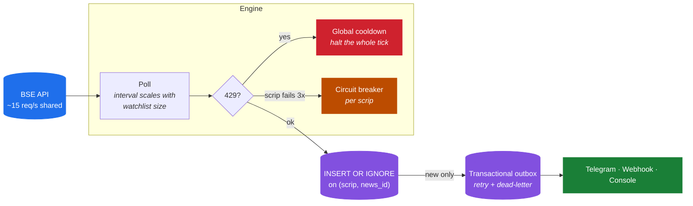
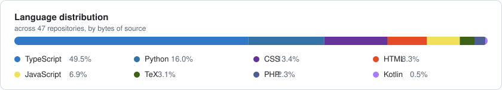

<h1 align="center">Vamshikiran Morlawar</h1>

  <b>Senior Software Engineer at Meta</b> (via Delart). 
  Ex-Razorpay, ex-Pine Labs — payments infrastructure. MTech CSE, IIT Kanpur. I build large-scale systems by day and ship small products on the side.

  
  
  
  
  

  
  

---

## 💼 Experience

**Senior Software Engineer** · Meta (via Delart) · *Bengaluru* · Oct 2026 –

**Senior Software Engineer** · Razorpay · 2025 – 2026
Payments infrastructure for India's largest fintech ecosystem — gateway integrations and the end-to-end QR UPI payment lifecycle.

**Software Engineer** · Pine Labs
Designed and optimised APIs for the core payment gateway. Shipped EMI with instant cashback and instant subvention. *Employee of the Quarter.*

**MTech, Computer Science & Engineering** · IIT Kanpur
Thesis under Prof. Arnab Bhattacharya. AIR 343 in GATE 2022 CS.

      

---

## 🚀 Shipped

Three products live and downloadable, built solo — store listings, privacy policies, payments and releases included.

<table>
<tr>
<td width="33%" valign="top">

### 🖥️ [DeskPilot](https://deskpilot-site.vercel.app/)

**Local AI agents for your filesystem**

Point it at a messy folder — it proposes a structure, you approve, it moves the files. One-click undo.

Runs on local `llama3.2` via Ollama. Nothing leaves your machine.

  

[Download](https://deskpilot-site.vercel.app/) · [Source](https://github.com/vamshimorlawar/deskpilot)

</td>
<td width="33%" valign="top">

### 📔 [My Diary](https://chromewebstore.google.com/detail/my-diary/nfdcipolchlmlipikekpbbmpdpienajm)

**Save what you read, with its source**

Select text anywhere, right-click, saved — with page title, URL, tags and your notes.

Free tier plus a paid Pro tier with Gumroad licence activation.

  

[Install](https://chromewebstore.google.com/detail/my-diary/nfdcipolchlmlipikekpbbmpdpienajm) · [Source](https://github.com/vamshimorlawar/my-diary-extension)

</td>
<td width="33%" valign="top">

### ✍️ [Rephrase It](https://chromewebstore.google.com/detail/rephrase-it/cfpjlmhgebbmimbdkljdmoohcpnfoojk)

**Rewrite any text in 10 tones**

Select, right-click, pick a tone. Works in inputs and content-editable fields.

No backend. Your Gemini key stays in local storage.

  

[Install](https://chromewebstore.google.com/detail/rephrase-it/cfpjlmhgebbmimbdkljdmoohcpnfoojk) · [Source](https://github.com/vamshimorlawar/rephrase-extension)

</td>
</tr>
</table>

---

## 🔨 Currently building

### [bsewatch](https://github.com/vamshimorlawar/bsewatch) — BSE filings, the moment they land

   

The hard part isn't scraping. It's staying alive against an undocumented API under a shared rate limit.

| Problem | Approach |
|---|---|
| Shared rate limit | Tick interval derived from watchlist size, not hardcoded |
| One bad symbol | Per-scrip circuit breaker after N consecutive failures |
| `429` — the problem is us | Halt the entire tick, start a global cooldown |
| Telegram goes down | Transactional outbox; filings are never lost to a delivery failure |
| Two ticks race | Dedup by primary key, not `SELECT`-then-`INSERT` |
| Fixed interval is a fingerprint | Off-hours polling jittered within a range |

Design rationale and the end-to-end latency budget: [ARCHITECTURE.md](https://github.com/vamshimorlawar/bsewatch/blob/main/ARCHITECTURE.md)

---

## 🏆 Hackathons

**OpenCode Buildathon** · GrowthX × Razorpay — **Top 15 of 3,000+ applications**, 150 teams shortlisted.
Built an agentic payment system exploring how autonomous agents can drive payment flows with minimal human intervention.

**Sarvam AI Buildathon** — *Swayam*.
BSE/NSE announcements delivered as instant plain-language summaries in your own language, over WhatsApp, Telegram, or an automated phone call that reads them out. Built for the retail investor who gets a filing alert and can't parse the legalese.

**Computer by DevRev Hackathon** — AI-native on-call handoff.
A reusable Skill that pulls DevRev tickets, Slack threads, and GitHub PR history into a structured, source-cited handoff with decisions, blockers, and next actions — so on-call context isn't rebuilt from scratch every rotation.

---

## 📊 By the numbers

  <picture>
    <source media="(prefers-color-scheme: dark)" srcset="assets/stats-dark.svg">
    
  </picture>

  <picture>
    <source media="(prefers-color-scheme: dark)" srcset="assets/languages-dark.svg">
    
  </picture>

---

## 🧰 Stack

**Languages**

     

**Backend & data**

      

**Frontend & desktop**

    

**Tooling**

   

---

  
  

